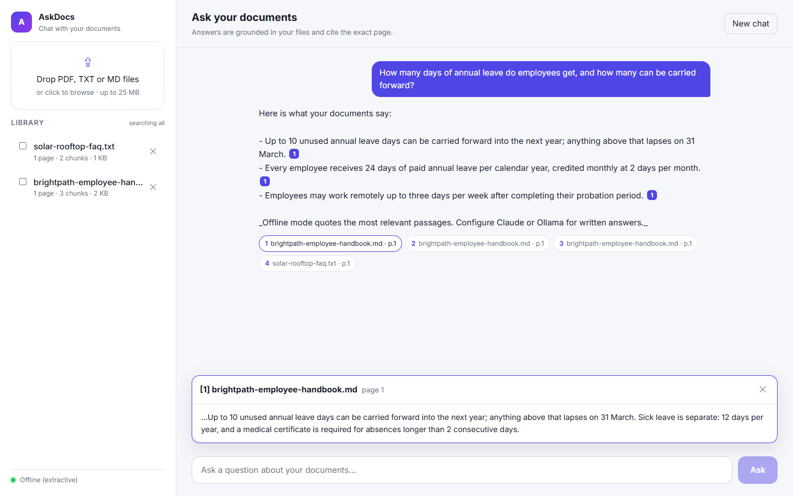
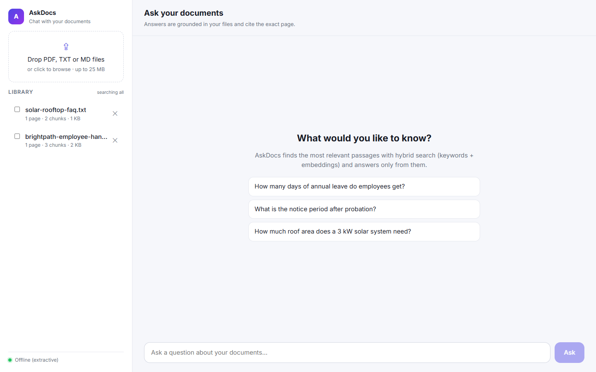
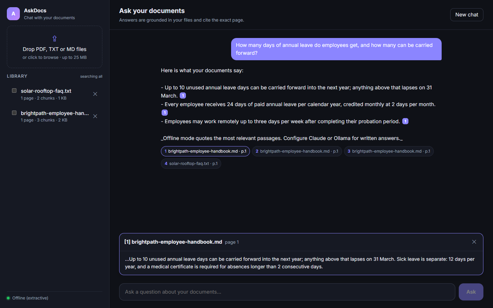
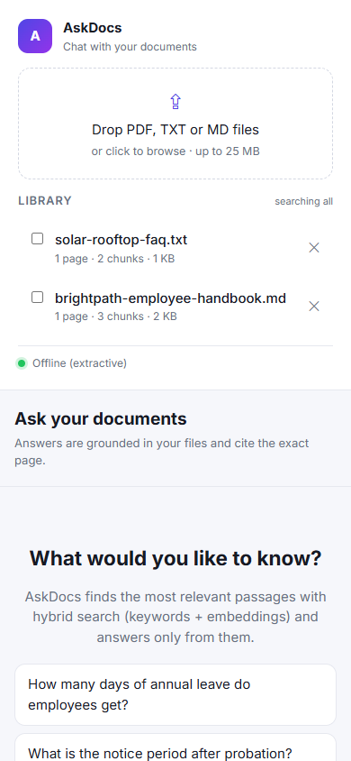
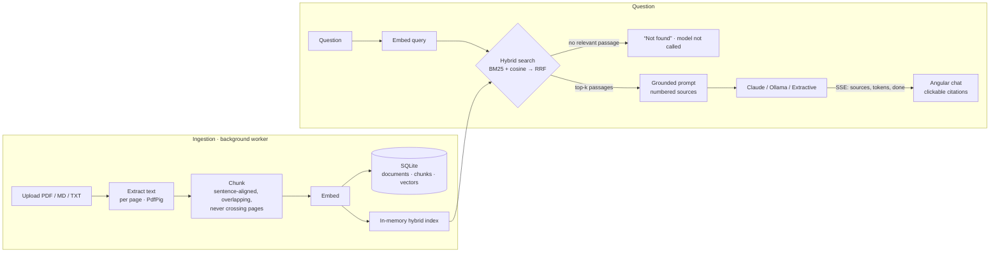

<h1 align="center">AskDocs — chat with your documents, with page-level citations</h1>

<p align="center">
  Upload PDFs, Markdown or text files and ask questions in plain language. AskDocs retrieves the most relevant passages
  with <b>hybrid search</b> (BM25 + embeddings), streams a grounded answer token by token, and cites the exact document and page.
  It runs fully offline by default, with <b>Claude</b> or a local <b>Ollama</b> model one setting away.
</p>

<p align="center">
  <a href="https://github.com/KumarNitish007/askdocs-rag/actions/workflows/ci.yml"></a>
  
  
  
  
  
</p>



## Highlights

| | |
|---|---|
| **Grounded answers** | The model sees only the retrieved passages, numbered `[1]…[n]`, and must cite them. If nothing relevant is found, the **relevance gate** answers "not found" without calling the model, so there's nothing to hallucinate from. |
| **Hybrid retrieval** | **BM25** catches exact terms (names, codes, figures); **vector similarity** catches paraphrases; **Reciprocal Rank Fusion** merges the two rankings without score calibration. |
| **Page-accurate citations** | PDFs are parsed per page and chunks never cross a page boundary, so every `[n]` maps to one page. Click a citation to see the passage that matched. |
| **Streaming** | Answers stream over **Server-Sent Events** (sources first, then tokens), with stop / cancel. |
| **Pluggable models** | `Extractive` (default: no model, quotes the best sentences) · `Ollama` (free, local, private) · `Claude` (official Anthropic C# SDK, `claude-opus-5-5`). Embeddings: offline feature hashing or Ollama `nomic-embed-text`. |
| **Ingestion pipeline** | Uploads return immediately; a background worker extracts, chunks (sentence-aligned, overlapping) and embeds. Re-indexes automatically if you switch embedding models. Duplicate uploads are detected by SHA-256. |
| **Safety & limits** | Extension and PDF magic-byte checks, size limits, generated storage names (no client paths on disk), per-IP rate limiting on `/api/ask`, and prompt instructions to treat document text as untrusted. |

| Light | Dark | Mobile |
|---|---|---|
|  |  |  |

## How it works



## Run it

```bash
dotnet run --project src/AskDocs.Api        # http://localhost:5200 - offline mode, no setup
```

Upload the files in [`samples/`](samples) (fictional documents written for this demo) and try
*"How many annual leave days can be carried forward?"*

**Use Claude** (the key is read from the environment, never from config files):

```bash
export ANTHROPIC_API_KEY=...                # PowerShell: $env:ANTHROPIC_API_KEY="..."
dotnet run --project src/AskDocs.Api -- --AI:Provider=Claude
```

The Claude integration uses the official Anthropic SDK with streaming, `claude-opus-5-5` at `medium` effort (configurable in
`appsettings.json`), handling for `refusal` and `max_tokens` stop reasons, and server-side refusal fallback enabled.

**Use a local model with Ollama**:

```bash
ollama pull llama3.2 && ollama pull nomic-embed-text
dotnet run --project src/AskDocs.Api -- --AI:Provider=Ollama --AI:Embeddings=Ollama
```

**Docker:** `docker compose up --build` (offline mode on <http://localhost:8080>). See `docker-compose.yml` for the Ollama and Claude variants.

**Developing the UI:** `cd src/web && npm install && npm start` serves on <http://localhost:4200> and proxies `/api` to the running API.

## Configuration

| Setting | Default | Meaning |
|---|---|---|
| `AI:Provider` | `Extractive` | `Extractive` · `Ollama` · `Claude` |
| `AI:Embeddings` | `Hashing` | `Hashing` (offline) · `Ollama` |
| `AI:Claude:Model` / `Effort` / `MaxTokens` | `claude-opus-5-5` / `medium` / `8000` | Claude request settings |
| `AI:Ollama:BaseUrl` / `ChatModel` / `EmbeddingModel` | `localhost:11434` / `llama3.2` / `nomic-embed-text` | Ollama settings |
| `Retrieval:TopK` | `6` | passages given to the model |
| `Retrieval:MinSimilarity` | `0.35` | relevance gate for passages with no keyword match |
| `Storage:MaxUploadMb` | `25` | upload size limit |
| `RateLimit:AsksPerMinute` | `20` | per-IP limit on questions |

## Tests

```bash
dotnet test                      # 31 tests, fully offline
cd src/web && npm run test:ci    # SSE parser + citation rendering
```

- **Retrieval and quality**: chunking (page boundaries, overlap, hard-wrap), PDF extraction per page (PDFs generated in the test), Markdown cleanup, tokenizer, embedding determinism, ranking cases for hybrid search, document scoping, snippet windows, extractive sentence ranking.
- **Claude request shape**: asserts the serialized request (model, effort, fallback, history) without calling the API.
- **HTTP + SSE integration**: boots the real app, uploads files over multipart, waits for background indexing and parses the event stream. Covers grounded answers with citations, the not-found gate, scoping, dedupe, rejected uploads, delete, and provider failure turning into an `error` event.

Design trade-offs (why hybrid search, why an in-memory index, why an extractive mode) are in **[docs/decisions.md](docs/decisions.md)**.

## Roadmap

- OCR for scanned PDFs (Tesseract) and DOCX support
- Re-ranking the top 20 with a cross-encoder before answering
- A retrieval eval set (questions → expected passages) tracked in CI, with recall@k
- Per-user libraries with authentication; a vector database (pgvector / Azure AI Search) for large corpora

## Author

**Nitish Kumar**, Senior .NET / Full Stack Developer
[Portfolio](https://kumarnitish007.github.io/portfolio-master/) · [LinkedIn](https://linkedin.com/in/nitishkumar043) · [GitHub](https://github.com/KumarNitish007)

More projects: [MiniERP](https://github.com/KumarNitish007/mini-erp-saas) (multi-tenant GST invoicing SaaS) ·
[OrderFlow](https://github.com/KumarNitish007/orderflow-microservices) (event-driven microservices with sagas and an outbox)
